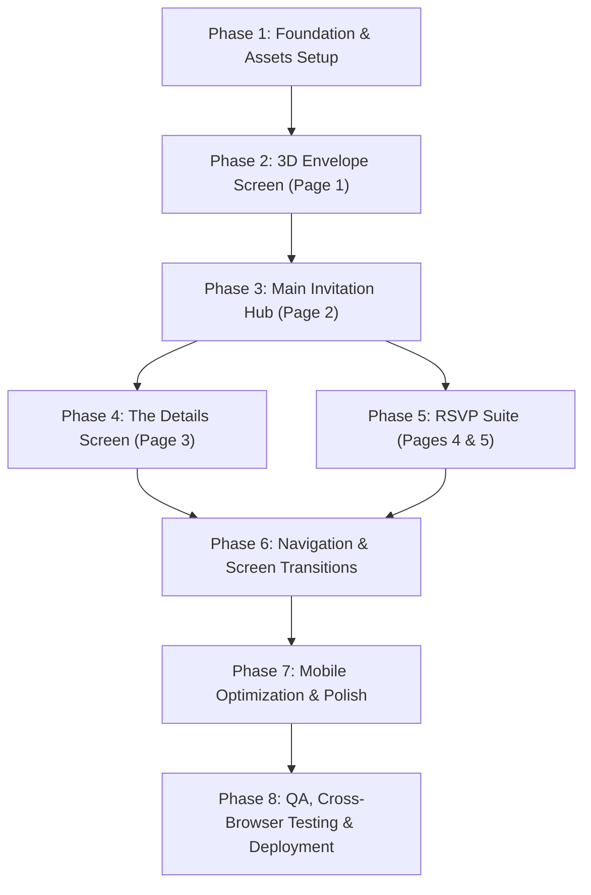

# Implementation Plan: Mary & Raja Wedding Invitation Website

> **Reference Template**: [Canva Design BW011](https://www.canva.com/design/DAHVvEDsQfM/Fqcdl-pbdLwktA9nn-_sPw/edit)  
> **Design Specification**: [design.md](file:///C:/Users/admin/Downloads/DeepPatel/WEDDING%20iNVITATION/design.md)  
> **Tech Stack**: Vanilla HTML5, CSS3, JavaScript (ES6+) — Zero external runtime dependencies  
> **Target Wedding Date**: January 16, 2027 at 15:00 GST (Dubai Time)  

---

## 1. Project Overview & Deliverables

This implementation plan details the step-by-step roadmap to build a responsive, luxury digital wedding invitation website for **Mary Barbar & Raja Tarazi**. The website faithfully reproduces all 5 pages and interactions from the Canva design using pure HTML, CSS, and JavaScript.

### Core Objectives
1. **Tactile Digital Invitation**: Realistic 3D unsealing envelope animation on initial load/tap.
2. **Fluid Screen Navigation**: Seamless transitions between the Landing Hub, The Details page, and the RSVP Form without full page reloads.
3. **Accurate Live Countdown**: Precision countdown to the wedding ceremony in Dubai (GST / UTC+4).
4. **Interactive Wedding Guide**: Venues with map deep-links, 6-stage event timeline with SVG icons, dress code guide, registry link, and fluid FAQ accordions.
5. **Functional RSVP System**: Client-validated form with conditional plus-one input, persistent storage / webhook support, and instant confirmation feedback.
6. **Zero-Dependency Architecture**: Ultra-fast loading (< 1 second), lightweight, and easily deployable anywhere (GitHub Pages, Netlify, Vercel, or traditional shared hosting).

---

## 2. Project Directory Structure

```
WEDDING iNVITATION/
├── index.html                  # Single-page HTML document containing all 5 screens/views
├── css/
│   ├── variables.css           # Design tokens, color palette, typography definitions
│   ├── base.css                # CSS resets, global typography, smooth scrolling
│   ├── envelope.css            # 3D CSS envelope, lace borders, wax seal styling & keyframes
│   ├── components.css          # Cards, countdown clock, timeline, accordions, badges
│   ├── rsvp.css                # Form inputs, radio cards, validation states, confirmation card
│   └── responsive.css          # Breakpoints (mobile, tablet, desktop) and viewport fixes
├── js/
│   ├── app.js                  # Master application orchestrator & initialization
│   ├── envelope.js             # 3D envelope unseal & opening animation controller
│   ├── navigation.js           # View switching, hash/state navigation, back button handlers
│   ├── countdown.js            # Live countdown calculation engine (Dubai time zone)
│   ├── accordion.js            # Fluid FAQ accordion toggle mechanics
│   └── rsvp.js                 # Form handling, conditional fields, validation & submission
├── assets/
│   ├── icons/                  # High-fidelity SVG vector icons (Canva match)
│   │   ├── church.svg          # Ceremony venue icon & arrival timeline
│   │   ├── rings.svg           # Ceremony timeline icon
│   │   ├── champagne.svg       # Reception venue icon & cocktail hour
│   │   ├── dining.svg          # Dinner timeline icon
│   │   ├── cake.svg            # Cake cutting timeline icon
│   │   ├── disco.svg           # Afterparty disco ball timeline icon
│   │   ├── gift.svg            # Registry gift box icon
│   │   └── hearts-ribbon.svg   # Intertwined monogram hearts emblem
│   ├── images/                 # Optimized graphic assets & backgrounds
│   │   ├── calla-lily-hero.png # Fresh calla lilies for envelope & badges
│   │   ├── calla-lily-bg.png   # Soft calla lily background bouquet
│   │   ├── couple-bw.jpg       # Keepsake photo for RSVP card
│   │   └── paper-texture.png   # Subtle luxury parchment paper grain
│   └── reference/              # Canva preview & thumbnail references (saved locally)
│       ├── preview_page_1.png
│       ├── thumbnail_page_1.png
│       ├── thumbnail_page_2.png
│       ├── thumbnail_page_3.png
│       ├── thumbnail_page_4.png
│       └── thumbnail_page_5.png
├── design.md                   # Full design and UI/UX specification
└── plan.md                     # This implementation plan
```

---

## 3. Phased Implementation Roadmap



---

### Phase 1: Foundation, Typography & Assets Pipeline
- [ ] **1.1 Font Imports**: Configure Google Fonts in `<head>`:
  - `Pinyon Script` (for romantic luxury script headings and names)
  - `Cormorant Garamond` (weights 300, 400, 600, italic for editorial text)
  - `Montserrat` (weights 300, 400, 600, 700 for labels, buttons, and uppercase headers)
- [ ] **1.2 CSS Variables**: Setup `variables.css` with colors (`#fdf9f5`, `#131313`, `#ad9475`, `#e9d7c2`), font families, font sizes, transitions, and box shadows.
- [ ] **1.3 SVG Icon Generation**: Author clean, scalable SVG icons in `assets/icons/`:
  - Minimalist line-art matching Canva's custom sketches (church, rings, champagne, dining banquet, wedding cake, disco ball, gift box, tied hearts).
- [ ] **1.4 Base CSS Reset**: Configure `box-sizing: border-box`, typography defaults, button resets, and focus outlines.

---

### Phase 2: Screen 1 — The 3D Envelope Opening Experience
- [ ] **2.1 Envelope DOM Structure**:
  - Build HTML structure: `.envelope-wrapper`, `.envelope-back`, `.card-peek`, `.envelope-front`, `.envelope-flap`, `.wax-seal`.
- [ ] **2.2 CSS 3D Transforms**:
  - Apply CSS `perspective: 1200px` on wrapper.
  - Implement `.envelope-flap` with `transform-origin: top center` and `transform: rotateX(0deg)`.
  - Add lace scallop pattern along the edge using CSS `radial-gradient` or SVG border mask.
- [ ] **2.3 Wax Seal & Floral Decor**:
  - Style pearlescent oval seal with embossed monogram `M R`.
  - Position calla lilies across the lower envelope seam.
- [ ] **2.4 Opening Logic in `envelope.js`**:
  - Event listener on wax seal and envelope:
    1. Wax seal scales up and dissolves (`opacity: 0`).
    2. Envelope flap folds open backwards (`rotateX(-180deg)`).
    3. Flap z-index shifts behind the card.
    4. Card inside slides up (`translateY(-80%)`).
    5. Screen 1 smoothly cross-fades into Screen 2 (Main Invitation Hub).

---

### Phase 3: Screen 2 — Main Invitation Hub & Live Countdown
- [ ] **3.1 Hero Invitation Card**:
  - Replicate formal wording:
    - *"TOGETHER WITH THEIR FAMILIES"*
    - *"Mary Barbar & Raja Tarazi"*
    - *"CORDIALLY INVITE YOU TO THEIR WEDDING"*
    - *"JANUARY 16, 2027 / DUBAI, UNITED ARAB EMIRATES"*
  - Position within floral bouquet background framing.
- [ ] **3.2 "The Next Chapter Begins" Story**:
  - Flourished script title.
  - Formatted three-paragraph heartfelt note in italic serif with elegant line height.
  - Script sign-off: *"With Love, Mary & Raja"*.
- [ ] **3.3 Live Countdown Clock (`countdown.js`)**:
  - Target Date: `2027-01-16T15:00:00+04:00` (Dubai GST).
  - Calculate `days`, `hours`, `minutes`, `seconds`.
  - Reusable interval updating DOM with padded 2-digit numbers (`00`).
  - Graceful fallback when countdown completes ("Celebration in progress!").
- [ ] **3.4 Navigation Portal Cards**:
  - Card 1: Painted parchment petal badge with button: `VIEW DETAILS`.
  - Card 2: Photo keepsake envelope with button: `RESPOND HERE` / `RSVP ONLINE`.
- [ ] **3.5 Monogram Footer**:
  - Intertwined hearts SVG emblem.
  - *"We can't wait to celebrate with you!"*
  - *"^ BACK TO ENVELOPE"* smooth scroll trigger.

---

### Phase 4: Screen 3 — The Details View
- [ ] **4.1 Navigation Header**:
  - Sticky or top `< GO BACK` button to return immediately to Screen 2.
- [ ] **4.2 Venues Grid**:
  - **Ceremony Card**:
    - Church sketch icon, time (3:00 PM, arrive by 2:30 PM), location (*Our Lady of Annunciation Greek Orthodox Church*).
    - `VIEW ON MAP` button linking to Google Maps search URL.
  - **Reception Card**:
    - Champagne flutes icon, time (6:00 PM), location (*Address Montgomerie, Dubai, UAE*).
    - `VIEW ON MAP` button linking to Google Maps search URL.
- [ ] **4.3 Schedule of Events Timeline**:
  - Title: `Schedule of Events`.
  - 6 timeline cards with corresponding SVG icon, time, and event title:
    1. 2:30 PM — Guest Arrival
    2. 3:00 PM — The Ceremony
    3. 6:00 PM — Cocktail Hour
    4. 8:00 PM — Dinner
    5. 10:00 PM — Cake Cutting
    6. 12:00 AM — Afterparty
- [ ] **4.4 Guest Guidelines (Children & Dress Code)**:
  - Children policy card (adults-only celebration note).
  - Dress code card: *"FORMAL GARDEN THEMED ATTIRE"* with dedicated bullet points for ladies (long gowns, midi, cocktail dresses) and gentlemen (formal suits/tuxedos in palette).
- [ ] **4.5 Wedding Registry Section**:
  - Gift box icon, invitation wording, and `WEDDING REGISTRY` external CTA button.
- [ ] **4.6 Wedding FAQs Accordion (`accordion.js`)**:
  - Accordion item 1: Ceremony & reception indoors or outdoors + Dubai evening temperature tip.
  - Accordion item 2: Parking & valet availability at Address Montgomerie vs. church.
  - Accessible keyboard control (`Enter`/`Space`) and ARIA attributes (`aria-expanded`).

---

### Phase 5: Screen 4 & 5 — RSVP Suite
- [ ] **5.1 RSVP Prompt View (Screen 4)**:
  - Elegant prompt card: *"Your presence would mean the world to us"*.
  - Deadline notice: `KINDLY RESPOND BY DECEMBER 13, 2026`.
  - Action button: `PLEASE RSVP HERE` -> activates Screen 5.
- [ ] **5.2 RSVP Interactive Form (Screen 5)**:
  - Fields:
    1. `Your Name:` (`<input type="text" required>`)
    2. `Will you be joining us on this special day?` (Custom styled radio buttons for "Yes, I'd love to!" vs "Sorry, I won't be able to attend.")
    3. `Will you be bringing someone to share this moment with you?` (Custom styled radio buttons for "Yes, I'll be bringing someone." vs "No, I'll be attending alone.")
    4. `If you are bringing a guest, please tell us their name:` (Conditional input field; hidden by default, expands when plus-one is Yes).
    5. Submit Button: `SUBMIT RSVP` with hover animation.
- [ ] **5.3 Submission Handling in `rsvp.js`**:
  - Client-side validation: ensure name is entered and options are chosen.
  - Save submission record to `localStorage` (so guest sees their response if they return).
  - Provide easy webhook/endpoint hook for external submission (e.g. Google Sheets API, Formspree, or EmailJS).
  - Transition form to animated Celebration / Confirmation Card:
    - *"Thank you, [Name]! We are thrilled to celebrate with you on January 16, 2027!"*

---

### Phase 6: Navigation, View Routing & State Management
- [ ] **6.1 Single Page Navigation Architecture**:
  - Implement seamless screen transitions using data attributes (`data-screen="envelope"`, `data-screen="main"`, `data-screen="details"`, `data-screen="rsvp"`).
  - Update `window.location.hash` (`#envelope`, `#invitation`, `#details`, `#rsvp`) so browser back/forward buttons work naturally.
- [ ] **6.2 Transition Effects**:
  - Smooth fade/slide transitions between views (300ms CSS opacity & translate).
  - Automatically scroll view to top when navigating into Details or RSVP.

---

### Phase 7: Responsive Refinement, Audio & Polish
- [ ] **7.1 Breakpoint Optimization**:
  - Mobile portrait (< 480px): Envelope scales to 92vw; single-column venue cards; compact countdown digits.
  - Tablet (481px - 820px): Proportional card widths, balanced typography.
  - Desktop (> 821px): Maximum card width 740px, centered luxury stationery feel.
- [ ] **7.2 Optional Background Music Player**:
  - Discreet floating sound toggle button (bottom right corner).
  - Plays gentle romantic acoustic piano / strings upon user gesture (browser autoplay compliant).
- [ ] **7.3 Performance Tuning**:
  - Optimize asset loading using `<link rel="preload">` for key fonts.
  - Test Lighthouse metrics (Target: 95+ across Performance, Accessibility, Best Practices).

---

### Phase 8: Verification, Testing & Deployment
- [ ] **8.1 Visual Regression Audit**:
  - Compare every section against the downloaded Canva reference images in `assets/reference/`.
- [ ] **8.2 Cross-Browser & Device Testing**:
  - Chrome, Safari (iOS), Firefox, Edge.
  - Verify 3D envelope transform performance on mobile Safari / Chrome Android.
- [ ] **8.3 Social Sharing & Meta Tags**:
  - Add Open Graph (`og:title`, `og:description`, `og:image`) and Twitter Cards in `<head>` so WhatsApp, iMessage, and Instagram link previews display the couple's wedding card and preview image.
- [ ] **8.4 Deployment Readiness**:
  - Zero build step: works out-of-the-box by double-clicking `index.html` or deploying to any static host.

---

## 4. Technical Specifications & Implementation Details

### 4.1 Countdown Timer Logic (`countdown.js`)
```javascript
const WEDDING_DATE = new Date('2027-01-16T15:00:00+04:00').getTime();

export function initCountdown() {
  function update() {
    const now = Date.now();
    const diff = WEDDING_DATE - now;

    if (diff <= 0) {
      document.getElementById('countdown-container').innerHTML = 
        '<p class="celebration-started">Our celebration has begun!</p>';
      return;
    }

    const days = Math.floor(diff / (1000 * 60 * 60 * 24));
    const hours = Math.floor((diff % (1000 * 60 * 60 * 24)) / (1000 * 60 * 60));
    const minutes = Math.floor((diff % (1000 * 60 * 60)) / (1000 * 60));
    const seconds = Math.floor((diff % (1000 * 60)) / 1000);

    document.getElementById('days').textContent = String(days).padStart(2, '0');
    document.getElementById('hours').textContent = String(hours).padStart(2, '0');
    document.getElementById('minutes').textContent = String(minutes).padStart(2, '0');
    document.getElementById('seconds').textContent = String(seconds).padStart(2, '0');
  }

  update();
  setInterval(update, 1000);
}
```

### 4.2 FAQ Accordion Logic (`accordion.js`)
```javascript
export function initAccordions() {
  const items = document.querySelectorAll('.faq-item');
  items.forEach(item => {
    const trigger = item.querySelector('.faq-question');
    trigger.addEventListener('click', () => {
      const isOpen = item.classList.contains('active');
      items.forEach(i => i.classList.remove('active'));
      if (!isOpen) {
        item.classList.add('active');
        trigger.setAttribute('aria-expanded', 'true');
      } else {
        trigger.setAttribute('aria-expanded', 'false');
      }
    });
  });
}
```

### 4.3 View Switching Architecture (`navigation.js`)
```javascript
export function switchScreen(targetScreenId) {
  const screens = document.querySelectorAll('.screen-view');
  screens.forEach(screen => {
    if (screen.id === targetScreenId) {
      screen.classList.add('active');
      window.scrollTo({ top: 0, behavior: 'smooth' });
    } else {
      screen.classList.remove('active');
    }
  });
}
```

---

## 5. Verification Checklist

| Item | Requirement | Verification Method | Status |
| :--- | :--- | :--- | :--- |
| **Fonts** | Pinyon Script, Cormorant Garamond, Montserrat | Visual inspection of letterforms against Canva | Planned |
| **Envelope** | 3D flap rotation + card slide out on click/tap | Click wax seal on desktop and mobile touch | Planned |
| **Names & Dates** | Mary Barbar & Raja Tarazi, Jan 16 2027, Dec 13 2026 RSVP | Text proofreading | Planned |
| **Countdown** | Accurate Days : Hours : Minutes : Seconds | Live countdown verification against UTC+4 | Planned |
| **Venues** | Our Lady of Annunciation & Address Montgomerie | Test `VIEW ON MAP` links open Google Maps | Planned |
| **Timeline** | 6 event points with icons (2:30 PM to 12:00 AM) | Verify all 6 events match Canva timeline | Planned |
| **Guest Policy** | Adults-only notice & Dress code specifics | Confirm exact copy from Canva Page 3 | Planned |
| **FAQs** | 2 expandable accordions for Indoors/Outdoors & Parking | Click triggers to verify smooth expand/collapse | Planned |
| **RSVP Form** | Full name, attendance, plus-one with guest name reveal | Fill form, test submit, check confirmation | Planned |
| **Mobile** | Responsive on screens down to 360px | Inspect in Chrome DevTools Device Mode | Planned |
